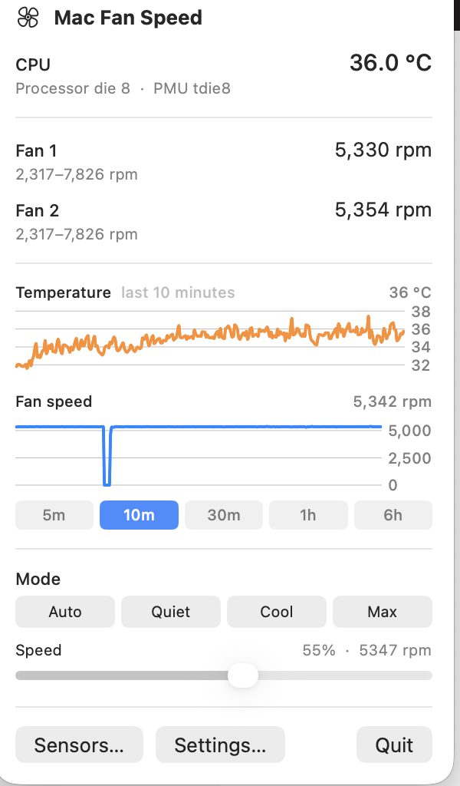
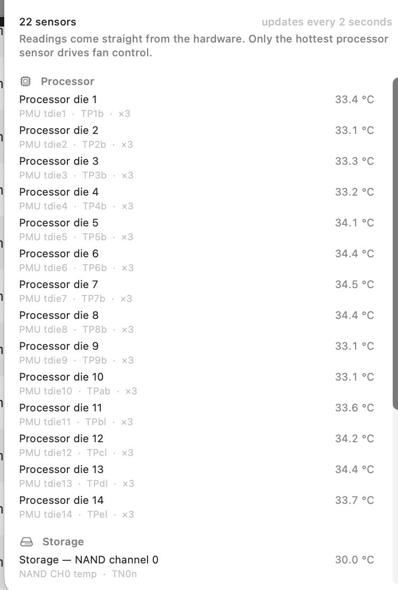

# Mac Fan Speed

A free, open-source macOS menu bar app that shows your CPU temperature and fan speed, and lets you control the fans yourself.

macOS keeps the fans off until the machine is already hot. That's fine for the hardware, but it makes a laptop uncomfortable on your lap. Mac Fan Speed lets you hold a gentle fan floor so the machine stays cool instead of warming up first and then spinning up loudly.

[](https://github.com/bradr23/mac-fan-speed/actions/workflows/ci.yml)
[](https://github.com/bradr23/mac-fan-speed/releases/latest)


 

## Features

- CPU temperature and fan RPM in the menu bar
- Manual fan control, with presets — **Quiet**, **Cool**, **Max** — plus your own
- Temperature and fan history charts, over 5 minutes to 6 hours
- **Every hardware sensor your Mac exposes**, in a Sensors window — grouped by what it measures, with readable names and the hardware's own name kept alongside
- Starts at login and restores whatever you last had set
- Automatic safety cutoff that returns the fans to macOS if things get hot

Presets are stored as a **percentage of each fan's range**, not a fixed RPM, so "Cool" means something sensible whether your fans top out at 3000 or 7800 rpm — and your settings still make sense on a different Mac.

## Requirements

- **Apple Silicon Mac** (M1 or later). Intel Macs are not supported: they read temperatures through an entirely different mechanism.
- **macOS 14 Sonoma** or later.

Fanless Macs such as the MacBook Air work in monitoring-only mode.

> **Tested on one machine.** Fan control is verified end to end on a MacBook Pro (M4 Pro, macOS 26.3). Other Macs are supported by design — fan count, sensor names and the firmware unlock are all detected at runtime rather than assumed — but they have not been tested. Known variation the app handles: 0 to 3 fans, two different sensor naming schemes, Macs that need no firmware unlock, and the lowercase mode key reported on M5.
>
> If something doesn't work on your Mac, [the diagnostics below](#reporting-a-problem-on-your-mac) usually pin it down in one go.

## Installing

**[Download the latest release](https://github.com/bradr23/mac-fan-speed/releases/latest)** — grab `MacFanSpeed-<version>.zip`, unzip it, and drag `MacFanSpeed.app` to your Applications folder. No building required.

Prefer to build it yourself? See [Building from source](#building-from-source) — it takes about ten seconds and avoids the Gatekeeper step below.

### First launch

Releases are **ad-hoc signed** rather than signed with a paid Apple Developer ID, so macOS quarantines the download and refuses to open it the first time. This is expected. Either:

**Right-click the app and choose Open**, then confirm. macOS remembers the choice.

Or clear the quarantine flag from Terminal:

```bash
xattr -dr com.apple.quarantine /Applications/MacFanSpeed.app
```

Building from source avoids this entirely — locally built apps are never quarantined.

Each release publishes a `.sha256` alongside the archive if you want to check the download:

```bash
shasum -a 256 MacFanSpeed-0.1.0.zip
```

### Enabling fan control

Reading temperatures needs no privileges. *Changing* fan speed does, so a small background service runs as an administrator and does nothing else.

Open **Settings → Fan Control → Install Helper…** and enter your password once. Everything the installer needs ships inside the app, so this works on a Mac that has never seen this repository. **Remove Helper** in the same place undoes it, handing your fans back to macOS first.

Without the helper the app still shows temperatures and fan speeds — you just can't change them.

### Starting automatically

**Settings → General → Start Mac Fan Speed at login.** Move the app to your Applications folder first: a login item records where the app is at the moment you enable it, and moving it afterwards leaves a stale entry.

### Updating

Replace `MacFanSpeed.app` with the new version, keeping the same location. Your settings and presets are kept.

One thing to know: replacing the app does **not** update the background fan-control service, which lives outside the app bundle and keeps running the version it was installed from. The app notices and tells you — **Settings → Fan Control** shows *Running an older version* with an **Update Helper…** button. Monitoring and fan control keep working in the meantime.

Keep only one copy of the app. Two copies in different folders both start, both show a menu bar icon, and both try to drive the fans; newer versions detect this and the second copy exits.

## Safety

Holding fans **slower** than macOS would choose can let the machine run hotter than Apple intends. These protections are not optional and cannot be turned off:

- If the CPU reaches **95 °C**, the fans return to macOS control immediately and stay there until the machine drops below 85 °C.
- If temperature readings become unavailable while fans are under manual control, the app hands them back rather than holding a speed blind.
- If the app crashes or is force-quit, the background service returns the fans to macOS within a few seconds — measured at 3 seconds on the development machine.
- Quitting, sleeping, or removing the helper all restore automatic control. Sleep waits for the fans to be handed back before the machine goes down.

Apple Silicon Macs also throttle themselves in hardware regardless of fan speed. That said, this software comes with no warranty; see [LICENSE](LICENSE).

## Building from source

Requires Xcode Command Line Tools; full Xcode is only needed to run the tests.

```bash
git clone https://github.com/bradr23/mac-fan-speed.git
cd mac-fan-speed
./scripts/build.sh release
open build/MacFanSpeed.app
```

There is no Xcode project — the app builds with Swift Package Manager, and `scripts/build.sh` assembles the `.app` bundle. `swift test` runs the test suite, and `./scripts/release.sh` produces a release archive.

See [CONTRIBUTING.md](CONTRIBUTING.md) for the safety rules, how to verify fan control on your own Mac, and how to add support for a model that isn't recognised yet.

### The command-line tool

`fanctl` exercises the same sensor and SMC layer without the UI:

```bash
./build/fanctl fans          # every fan: current, min, max, target, mode
./build/fanctl temps         # CPU temperature sensors
./build/fanctl temps --dump  # every sensor and how it was classified
./build/fanctl watch         # live view, refreshing every 2 seconds
./build/fanctl keys F0       # SMC keys, with their type and attributes
sudo ./build/fanctl auto     # return all fans to automatic control
```

## Reporting a problem on your Mac

Sensor names and fan control differ between chip generations, and this has only been tested on one machine. If temperatures show as unavailable, look wrong, or fan control does not work, please [open an issue](https://github.com/bradr23/mac-fan-speed/issues) and include:

```bash
./build/fanctl temps --dump
sudo ./build/fanctl probe-mode
```

The first lists every sensor your Mac exposes and how the app classified it — the same readings the app's **Settings → Sensors** tab shows. The second determines what your firmware will accept for fan control, and always restores your original settings afterwards. Between them they are usually enough to add support.

## How it works

The app reads fan speeds from the System Management Controller and CPU temperatures through Apple's HID sensor interface. A separate root helper performs the only privileged operation — setting a fan's mode and target RPM — and re-validates every request against the limits your own hardware reports.

From the M3 generation onward, `thermalmonitord` holds the fans and the firmware refuses direct mode writes. Taking control requires setting the `Ftst` unlock key and then retrying until the firmware yields, which takes a few seconds. [SPEC.md](SPEC.md) documents all of this in full.

## Acknowledgements

- [exelban/stats](https://github.com/exelban/stats) (MIT) — reference for Apple Silicon fan control
- [narugit/smctemp](https://github.com/narugit/smctemp) — reference for M-series temperature sensors

## Changes

See [CHANGELOG.md](CHANGELOG.md).

## License

MIT — see [LICENSE](LICENSE).
